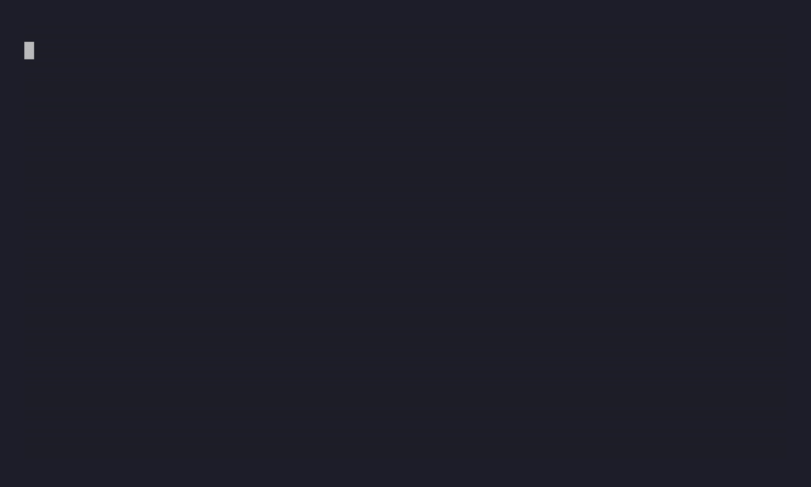

# REAShield

[](https://www.npmjs.com/package/reashield)
[](./LICENSE)
[](https://github.com/HMAKT99/reashield/actions/workflows/ci.yml)
[](https://github.com/HMAKT99/reashield/actions/workflows/python-ci.yml)



> ## REA reverse-engineers any app. REAShield makes it come back empty.

[REA](https://github.com/morluto/rea) — the #1 trending repo on GitHub — lets an AI
agent reverse-engineer your shipped app in one command, no source code needed.
**REAShield is the defensive counter:** drop it into your build and it hardens what
you ship (JavaScript / Electron / Python) so automated reverse engineering comes
back empty.

### Measured against the real attacker — not claimed

- **REA** (`rea-agents`) recovered **6 protected tokens → 0** after hardening.
- **webcrack** fully deobfuscated the hardened client (1103 changes, string array
  decoded) and *still* recovered **0** — because the secrets were relocated/sealed,
  not just obfuscated.

```bash
npm i -D reashield
npx reashield build        # hardened client + generated server skeleton
npx reashield test --rea   # run the REAL REA on before/after; score what it recovers
```

Python front-end: `pip install reashield` (see [`python/`](./python)).

> ### Honest promise & limits — read this
> **Offline code can never be made unbreakable.** If a machine must run it, the
> machine has it, so it can always be extracted given effort — obfuscation, WASM and
> bytecode only raise the cost. REAShield's job is to defeat the **automated** attack
> (the one REA just handed everyone) and raise a human analyst's cost from minutes to
> days. The only *truly* unrecoverable code is code you don't ship — run it
> server-side (`mode: "relocate"`). Defensive-only, behavior-preserving, transparent
> (no phone-home). It hardens code **you own and ship**; it won't help bypass anyone
> else's DRM, license checks, or anti-cheat.

---

## Use it from an AI agent (MCP server)

REA is an MCP server that hands an agent *reverse-engineering* tools. REAShield
ships the **defensive mirror** — an MCP server that hands an agent **hardening**
tools, so Claude Code / Cursor can inspect, harden, and measure a project from chat.

Tools: **`reashield_doctor`** (what's exposed), **`reashield_harden`** (harden it),
**`reashield_measure`** (run the real REA and report the recovery score).

```bash
# Claude Code
claude mcp add reashield -- npx -y reashield-mcp

# Cursor / other MCP clients — add to your MCP config:
# { "mcpServers": { "reashield": { "command": "npx", "args": ["-y", "reashield-mcp"] } } }
```

---

## As a skill

REAShield also ships an agent **skill** — a process-first workflow for hardening
shipped code against reverse engineering, meant to be followed by Claude Code /
Cursor: [`skills/protect-shipped-code`](./skills/protect-shipped-code/SKILL.md).

---

## Two front-ends, one architecture

REAShield is a monorepo. The same durable idea — **move secrets off-device, turn
static facts into runtime facts, and measure the result** — is implemented for
two ecosystems:

| Front-end | Install | Protects | Status |
|---|---|---|---|
| **JavaScript / npm / Electron** (this package) | `npm i -D reashield` | shipped JS bundles, `app.asar` | published |
| **Python** ([`python/`](./python)) | `pip install -e python` | shipped `.py` apps | in this repo |

Both share the pillar ordering below. The Python package mirrors relocation,
sealing (AES-GCM), string indirection, name mangling, polymorphism, decoys, and
a measurement harness — with a safety analyzer that **refuses rather than
miscompiles**. See [`python/README.md`](./python/README.md).

Interpreted / source-shipped languages are the natural fit; compiled-to-native
(Go, Rust, C/C++) ship no source and are a different reverse-engineering game.

---

## Why this works (the threat model)

REA's JavaScript/Electron path is **static** — it never runs your app. It reads
your bundle, rebuilds a graph of **modules, imports, routes, IPC channels and
strings**, then hands a coding agent a compact **summary** to reason over. It
honestly leaves anything **computed at runtime unresolved** and drops
relationships when a graph gets too big.

So the durable defenses either **move secrets off-device** or **turn static
facts into runtime facts** REA can't resolve. Plain obfuscation — the thing
LLM-assisted deobfuscation erodes fastest — is the replaceable outer skin, not
the foundation.

## Defense pillars (ordered by durability)

| Pillar | `mode` / layer | What it does | Honest limit |
|---|---|---|---|
| **Server-side relocation** | `relocate` | Moves the real body to a generated server skeleton; ships only an opaque remote-call stub through one endpoint. The secret never ships. | Needs a secured backend; the request/response boundary is observable. |
| **Encrypted sealing** (`max`) | `seal` | Ships the module as ciphertext, decrypted at runtime with a key fetched from your server. | Needs connectivity; does **not** stop a human dumping decrypted memory. |
| **WASM** | `wasm` | Compiles numeric-subset logic to a real WebAssembly module, off REA's JS graph path. | Numeric subset only; falls back to `obfuscate` (reported) outside it; wasm can still be decompiled. |
| **Dynamic graph** (`max`) | `dynamicGraph` | Computed imports + runtime dispatch table — deletes the call/import edges REA recovers. | CPU cost; scoped to protected regions. |
| **Graph starvation** | `flattenBundle`, `stripSourceMaps`, `stringIndirection`, `dynamicChannels` | One module, no maps, no semantic plaintext strings, computed channel names. | Obfuscation erodes over time. |
| **Polymorphism** | `polymorphic` | Per-build re-randomization of names, strings **and structure** — defeats version diffing. | Cosmetic alone; pairs with the above. |
| **Decoys** | `decoys` | Inert fake "feature" clusters (hub + ring-linked members + a fake entry) with plausible route/IPC/key strings, shaped to look central in REA's summary. | Experimental; measured, can add size. |
| **Integrity** | `integrity` (off) | Fail-safe anti-tamper. | Does **not** defend REA's static path (REA never runs your app). |

## Install

```bash
npm install --save-dev reashield
```

## Quick start

```bash
npx reashield init          # scaffold shield.config.cjs
npx reashield build         # emit hardened client + server skeleton
npx reashield doctor        # show config, layers, costs, deps
npx reashield test          # measure before vs after (static; add --rea for real REA)
```

## Config (`shield.config.cjs`)

```js
module.exports = {
  input: "src/index.js",
  output: "dist-shielded",
  preset: "balanced",            // low | balanced | max
  protect: [
    { name: "licenseCheck", mode: "relocate" },  // strongest: off-device
    { name: "sealedCalc",   mode: "seal" },        // ciphertext + remote key (max)
    { name: "pricingLogic", mode: "wasm" },        // off the JS graph (fast-follow)
    { name: "featureGate",  mode: "obfuscate" },   // harden in place
  ],
  server: {
    enabled: true, out: "server-shielded", adapter: "express",
    endpoint: "/__s", keyEndpoint: "/__s/k", decoyCalls: false,
  },
  polymorphic: { enabled: true, seed: "auto" },     // "auto" rotates every build
  layers: {
    stripSourceMaps: true, flattenBundle: true, obfuscate: true,
    stringIndirection: true, dynamicChannels: true, dynamicGraph: false,
    decoys: { enabled: true, count: 5 }, integrity: false,
  },
};
```

`protect: ["a", "b"]` (a plain string array) is also accepted; each defaults to
`mode: "obfuscate"`. You can also put the config under a `reashield` key in
`package.json`.

### Presets

- **low** — strip maps, flatten, mangle. Fast, minimal size.
- **balanced** (default) — + string indirection, name homogenization, computed
  channels, opaque relocation boundary, structural polymorphism, 5 decoys. Low
  cost.
- **max** — + dynamic dispatch, encrypted sealing, decoy calls, control-flow
  flattening, dead-code injection, self-defending, ~15 decoys. Adds latency /
  CPU / size — `doctor` flags it.

## Bundler plugins (run hardening inside your existing build)

Instead of the CLI, harden as part of an esbuild / Rollup / Vite build. The
plugin runs the source-level pillars per module, then finalizes each output
chunk (decoys + obfuscation + source-map stripping + client-runtime injection)
and writes the server skeleton. `flattenBundle` is a no-op here — your bundler
already bundles; the plugin hardens its output. Configure the relocated/sealed
transport once via the global the plugin installs:
`globalThis.__configureShield({ transport, keyTransport })` (or let the default
`fetch` transport call your endpoints).

```js
// rollup.config.mjs
import { reashieldRollup } from "reashield/plugins";
export default {
  input: "src/index.js",
  output: { dir: "dist", format: "esm" },
  plugins: [reashieldRollup({ configPath: "shield.config.cjs" })],
};
```

```js
// vite.config.mjs  (Vite consumes the Rollup plugin interface)
import { reashieldVite } from "reashield/plugins";
export default { plugins: [reashieldVite({ configPath: "shield.config.cjs" })] };
```

```js
// esbuild build script
import { build } from "esbuild";
import { reashieldEsbuild } from "reashield/plugins";
await build({
  entryPoints: ["src/index.js"],
  bundle: true,
  outdir: "dist",
  plugins: [reashieldEsbuild({ configPath: "shield.config.cjs" })],
});
```

Each plugin accepts `{ config | configPath, cwd, seed }`. Note: the plugin
hardens every emitted JS chunk, so obfuscation cost applies to the whole output
— scope your build accordingly.

## The generated server skeleton

`relocate` and `seal` emit a `server-shielded/` directory holding the **real
logic and keys**. **Never ship it to users.** You run it behind your own auth +
TLS. REAShield scaffolds the Express/Fastify wiring and an in-process handler
for tests; **securing the endpoint is your responsibility** (it does not add
auth for you).

**Auth seam (you supply it).** Until you call `setAuthVerifier`, the endpoint is
**open** — secure it before shipping. The client attaches a token from a source
you configure; the server verifies it:

```js
// server
import { setAuthVerifier } from "./server-shielded/handlers.js";
setAuthVerifier(async (token, ctx) => (await myAuth.verify(token)) === true);

// client (wire once at startup)
__configureShield({ authToken: () => myAuth.currentToken() }); // (or globalThis.__configureShield in plugin builds)
```

**Adapters.** `adapter: "express" | "fastify" | "web" | "generic"`. The skeleton
always exports a cross-runtime `webHandler(request: Request): Promise<Response>`
that drops into Hono, Cloudflare Workers, Deno, Bun, or a Next.js route handler:

```js
import { webHandler } from "./server-shielded/handlers.js";
export const POST = (req) => webHandler(req); // Next.js app route, Workers fetch, ...
```

Relocated/sealed functions become `async` (they do a round-trip). Make sure your
call sites `await` them. They must be **self-contained** (no closure over
client-only module state).

## Behavior preservation

Hardening must never change what your program does. The bundled example
(`examples/sample-package`) proves identical outputs before and after hardening
— including relocated and sealed code, exercised through an in-process server —
and asserts decoys never execute. Run it with `npm run example:test`.

## Electron hardening

For Electron apps, REAShield adds an Electron-specific path (pair it with the JS
pillars above):

- **Dynamic IPC channel rewriting** — turns literal `ipcMain`/`ipcRenderer`/
  `webContents` channel strings into runtime-computed ones. REA leaves
  dynamically-computed IPC names **unresolved by design**, so this directly
  starves its graph. Value-preserving: both sides compute the identical string.
  Enable with `layers.ipcChannels: true`, or run standalone:
  ```bash
  npx reashield electron ipc src/main.js --out dist/main.js
  ```
- **V8 bytecode** (`bytenode`) — ship `.jsc` so the asar holds no readable JS:
  ```bash
  npx reashield electron bytecode dist/main.js --out dist/main.jsc
  ```
  **Caveat:** V8 bytecode is tied to the exact V8 version — compile with your
  target Electron's Node/V8, or the `.jsc` will not load. Raises cost against
  automated static JS analysis; it is not unbreakable.
- **Defensive fuses** (`@electron/fuses`) — flip the packaged binary to the
  hardened defaults (disable `RunAsNode`, Node CLI inspect args and
  `NODE_OPTIONS`; enable embedded ASAR integrity validation and
  `OnlyLoadAppFromAsar`). Run after packaging, in your `afterPack`:
  ```bash
  npx reashield electron fuses path/to/YourApp   # --dry to preview
  ```

`bytenode` and `@electron/fuses` are **optional** dependencies, loaded only when
you use these commands. Programmatic API: `import { rewriteIpcChannels,
compileToBytecode, recommendedFuses, applyFuses } from "reashield/electron"`.

## WASM backend (numeric crown jewels)

Mark a function `mode: "wasm"` and REAShield compiles it to a **real WebAssembly
module** (emitted as binary — no external toolchain) that is instantiated
synchronously, so behavior is unchanged. The arithmetic then lives in wasm
bytes, off REA's JS module-graph path. Supported today: numeric params, `const`
locals, a `return`, `+ - * /`, unary `-`, ternaries with comparison/`&&`/`||`/`!`
conditions, and `Math.(max|min|abs|floor|ceil|round|sqrt|trunc)`. Anything
outside that subset falls back to in-place obfuscation, reported (never silent).
Honest limit: wasm is a harder, different analysis league — not unbreakable.

## Durability: measure, don't trust

REA ships often. `reashield test` compares your own before/after artifact and
writes a baseline; the committed GitHub Action
(`.github/workflows/reashield-regression.yml`) re-measures across a matrix of
`rea-agents` versions and **fails when a newer REA recovers more than the
baseline allows**. That regression gate — not any single obfuscation trick — is
what keeps the shield strong over time.

`rea-agents` is an **optional** dev dependency. Without it, `reashield test`
falls back to static proxy metrics (source maps, import edges, string leakage,
protected-name leakage, secret-string removal).

## Roadmap

✅ Bundler plugins (esbuild/Rollup/Vite) · ✅ Electron path (bytenode, defensive
fuses, dynamic IPC rewriting) · ✅ WASM backend (numeric-subset → real wasm).

Next: broader WASM subset (control flow, strings) · broader server adapters +
auth helpers · summary-view-tuned decoys · ASAR packaging integration helpers.

## License

MIT. Use it to protect code you own and ship. Nothing here is a weapon against
anyone else's software.
